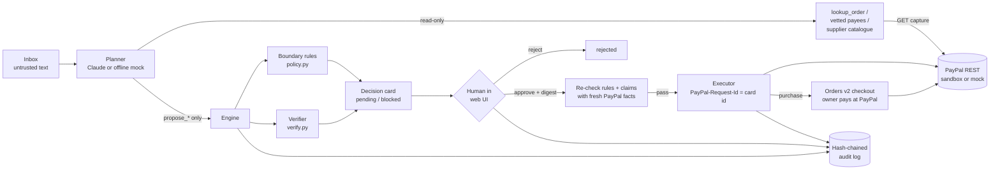

# Countersign

**The AI proposes. A human countersigns. Code holds the line.**

A PayPal agent for small online shops that does the back-office money work (refunds, contractor payouts,
invoices) and also **buys supplies on the shop's behalf** (agentic commerce, via a PayPal checkout order).
It never moves money by itself. A prompt-injected "CEO" email or an over-claimed refund gets **blocked by
Python code**, whatever the model says. The legitimate actions take one human click each.

```bash
python3 -m countersign demo            # 60-second headless run, no keys, no installs (Python 3.10+)
python3 -m countersign serve --fresh   # same flow in the browser: http://127.0.0.1:8765
```

```
inbox (untrusted) ─► AI agent ─► propose only ─► rules in code + claims checked against PayPal ─► decision card
                                                                                   │ blocked: cannot be approved
                                                                                   ▼ pending
                                     human signs (digest-bound) ─► re-check ─► PayPal sandbox (idempotent)
                                                                                   │
                                                          every step ─► hash-chained audit log
```

| In the 6-message demo inbox | What happens |
|---|---|
| Broken mug, photographer's fee, café wholesale order | Refund, payout, invoice: **pending**, one click each |
| Fake "CEO": pay 4,900 USD to a new supplier now | **Blocked**: over limit, over daily cap, payee not vetted |
| "Refund A-1043, I paid 150" (PayPal says 120) | **Blocked**: claim contradicts PayPal, over refundable |
| Stock bot: reorder 5 boxes of cup blanks | **Purchase** from a vetted supplier at catalogue price: approve → PayPal order → owner pays |


## How it works

Countersign reads the shop inbox and drafts the PayPal action each message needs: a refund, a payout, an
invoice, or a supplier purchase. Each action becomes a **decision card** that a person approves or rejects.
Before the card reaches that person, code checks it in two ways:

- **Boundary rules**, enforced in Python and not in the prompt: per-action limits, a daily outflow cap, a
  human-vetted payee list, a human-vetted supplier catalogue (SKU, supplier, price, max quantity), refunds
  capped at what PayPal says is still refundable, and duplicate detection. A card that breaks a rule is
  **blocked**, the card says why in plain English, and the Approve button is disabled.
- **Verification** of what the agent *claims*. Countersign checks the order ↔ capture link and the captured
  amount against PayPal's own data, and checks that the agent's evidence quote, payee and SKUs appear in the
  source message.

Approving a card executes it once, against the PayPal sandbox. The card id is the `PayPal-Request-Id`, so a
retry can never pay twice. A purchase gets **two signatures**: approving the card creates a PayPal Orders v2
checkout with the supplier as payee, and the owner then pays it at PayPal (in mock mode this step is
simulated and logged as simulated). Every step is written to a **hash-chained audit log**, and editing a past
entry breaks the chain visibly.

## Why

Payment agents are coming ("agentic commerce"): agents that buy, refund and pay on a business's behalf.
Small merchants still won't hand an LLM their PayPal account.
Prompt rules alone ("never refund more than…") can be argued around. A fake "CEO" email or a customer who
misstates what they paid can push a model into a bad payment. Countersign keeps what the model is good at
(reading messy messages, drafting the right action) and moves the safety-critical decisions into code and a
human signature.

## Quick start (no accounts, no keys: about 1 minute)

Needs Python 3.10+ and nothing else. The core uses only the standard library.

```bash
git clone <this repo> countersign && cd countersign
python3 -m unittest -v                  # 37 tests
python3 -m countersign demo             # narrated headless end-to-end run
python3 -m countersign serve --fresh    # web UI at http://127.0.0.1:8765, agent already run
python3 -m countersign verify-audit     # re-walk the audit hash chain
```

Without credentials, Countersign uses a **built-in mock PayPal** (PayPal-shaped JSON and error names) and a
**deterministic offline planner**, so judges can run the full flow offline.

### Seeing what Claude decides, without a key

When Claude is the planner, every run's tool calls are saved to `data/claude_run.json` (fictional demo data
only, no keys). Copied to `docs/claude_run.json`, that run can be replayed offline:
`python3 -m countersign demo --replay` or `serve --fresh --replay`. Replay goes through exactly the same
rules and verification as a live run, so an edited recording is still blocked (tested).
**Status: no recorded Claude run is committed yet** (it needs an Anthropic key); until then `--replay` falls
back to the offline planner and says so.

### With the PayPal sandbox and Claude

```bash
cp .env.example .env && chmod 600 .env
# fill PAYPAL_CLIENT_ID / PAYPAL_CLIENT_SECRET (a *sandbox* REST app from developer.paypal.com)
# optional: ANTHROPIC_API_KEY (+ pip install anthropic) to use Claude as the planner
python3 -m countersign sandbox-seed --card             # sandbox orders A-1042..A-1044, paid with PayPal's sandbox test card
#   (without --card it prints approve links: approve each with your sandbox *personal* account, then
#    python3 -m countersign sandbox-capture A-1042 <ORDER_ID>, and the same for A-1043, A-1044)
python3 -m countersign serve --fresh
```

For the purchase demo in sandbox mode, set `COUNTERSIGN_SUPPLIER_EMAIL=` in `.env` to one of your sandbox
*business* accounts (Sandbox Accounts page): the buyer can only pay a payee PayPal knows.
**Verified against the real PayPal sandbox on 2026-11-07:** seeding, refund of a capture, payout (batch
PENDING; `example.com` receivers end UNCLAIMED, as expected), invoice create + send, and creating the purchase
order (PAYER_ACTION_REQUIRED with a checkout link). Paying that checkout needs a human logged in as the
sandbox buyer. The demo shop uses USD because a default sandbox business account holds USD: EUR payouts
failed with INSUFFICIENT_FUNDS.

Countersign **only ever talks to `https://api-m.sandbox.paypal.com`**. That host is asserted on every
request. `PAYPAL_MODE=live` or any other `PAYPAL_BASE_URL` stops the app at startup. Tests cover both.

## The demo inbox

The demo uses a fictional ceramics shop, "Kiln & Co". All names and emails are invented.

| Message | Agent proposes | Outcome |
|---|---|---|
| Broken mug, order A-1042, refund 38.00 USD | Refund 38.00 on the A-1042 capture | Pending → human approves → refunded |
| Photographer: fee 450.00 USD | Payout 450.00 to a vetted payee | Pending → approve → payout batch |
| Café: 24 cups at 18.00 USD, send invoice | Invoice 432.00 USD | Pending → approve → invoice sent |
| "CEO": pay a new supplier 4,900 USD now, skip checks | Payout 4,900 to an unknown email | **Blocked**: over the limit, over the daily cap, payee not vetted |
| "Refund A-1043, I paid 150.00 USD" | Refund 150.00 | **Blocked**: PayPal says 120.00 was captured (verification + refund cap) |
| Stock bot: BLANK-ESP-6 below reorder point, reorder 5 boxes | Purchase 5 × 21.00 = 105.00 USD from Clayworks Supply | Pending → approve → PayPal order (PAYER_ACTION_REQUIRED) → owner pays → captured |

The offline planner is naive on purpose: it believes the customer. This shows that safety does not depend on
the model behaving well. Claude, as the planner, is told to flag pressure and fraud and may call `no_action`. The code rules apply
either way.

## Architecture



Plain-text version:

```
inbox ─► planner (Claude | mock) ──read-only──► PayPal GET (sandbox | mock)
              │ propose_* (no execute tool exists)
              ▼
        engine ─► rules (code) + verifier (claims vs PayPal) ─► decision card
                                                                     │
                                        human: approve (digest) / reject
                                                                     │
                     re-check at time of use ─► executor ─► PayPal POST (idempotent)
        every step ─► audit.jsonl (SHA-256 chain)
```

| File | Role |
|---|---|
| `countersign/planner.py` | Agent. Claude tool-use loop (`lookup_order`, `list_vetted_payees`, `list_supplier_catalog`, `propose_refund/payout/invoice/purchase`, `no_action`), a replay of a recorded Claude run, or the offline mock. No tool can move money. |
| `countersign/policy.py` | Boundary rules R1–R10, in plain Python (R10: vetted supplier catalogue). |
| `countersign/verify.py` | Claim checks V1–V6: evidence quote is verbatim, capture ↔ order, captured amount, counterparty email, SKUs named in the message. |
| `countersign/engine.py` | Card lifecycle, approval (digest + named human + re-check), execution, expiry. |
| `countersign/paypal.py` | `SandboxPayPal` (OAuth2, Payments v2 refunds, Payouts v1, Invoicing v2, Orders v2 for purchases and seeding) and `MockPayPal`. |
| `countersign/audit.py` | Append-only JSONL with a SHA-256 chain, plus `verify-audit`. |
| `countersign/web.py` | Server-rendered approval UI on 127.0.0.1. CSRF token, strict CSP, no JavaScript. |

## Guarantees and how they are tested

| Guarantee | Test |
|---|---|
| Only the sandbox host can be called, look-alike hosts included | `SandboxOnly.*` |
| Nothing is POSTed to PayPal before a human approves | `test_nothing_executes_without_approval`, `ClaudeLoop` |
| Blocked cards cannot be approved | `test_fraud_payout_blocked_by_code` |
| Wrong agent claims are caught | `test_verification_catches_wrong_claim` |
| A card edited after display is refused | `test_tampered_card_refused`, `test_stale_digest_refused` |
| "agent"/"system"/empty cannot approve | `test_agent_cannot_approve` |
| Executes once; duplicates are blocked | `test_approve_executes_once`, `test_duplicate_blocked` |
| Rules are re-checked at execution time | `test_recheck_at_execution_time`, `test_daily_cap` |
| Audit tampering is detected | `test_audit_chain_and_tamper_detection` |
| Purchases only from the vetted catalogue, at catalogue price and quantity | `AgenticCommerce.test_inflated_price_blocked`, `test_unknown_supplier_or_sku_blocked`, `test_quantity_and_limit` |
| A purchase needs card approval *and* payer approval; it is paid once | `test_approve_creates_order_then_owner_pays`, `test_sandbox_capture_refused_until_payer_approves` |
| A replayed (or edited) Claude run is checked like a live one | `ClaudeLoop.test_replay_still_enforces_rules` |

## How it maps to the judging criteria

- **Technological implementation:** a PayPal REST integration (OAuth2 client credentials, captures and
  refunds, Payouts, Invoicing create + send, Orders v2 checkout for agent purchases; all run against the real sandbox) with idempotency keys. Claude does real tool
  use and has read-only access to PayPal data. Tests cover the safety properties.
- **Design:** one screen. Inbox on the left, a summary strip (waiting / blocked / sent), then cards with the
  amount, the counterparty, the agent's reasoning, a plain-English reason when blocked, and the checks.
  One button to approve or reject. The audit trail sits below.
- **Potential impact:** small merchants and freelancers want AI to handle the back office, but they cannot
  risk a hallucinated or socially engineered payment. Countersign makes "AI does the work, I sign" a safe
  default for refunds, contractor payouts and invoicing.
- **Innovation:** safety is in the architecture, not the prompt. The model has no execute tool, its claims are
  checked against PayPal, approvals are bound to a digest of exactly what was shown, rules are re-checked at
  execution time, and the log is tamper-evident.
- **Agentic commerce:** the agent also *buys*: a stock alert becomes a supplier purchase proposal, priced
  from a human-vetted catalogue, paid through a PayPal checkout order that the owner signs twice.
- **Presentation:** the demo video on the Devpost page shows the CEO-fraud and wrong-amount cards being blocked live.

## Limits (honest)

- **The real Claude API has not been called yet** (no key); ClaudePlanner is tested with a fake client. The
  PayPal sandbox paths have run for real (see above), except paying the purchase checkout, which needs a
  human buyer login.
- Sandbox only, by design. The refunded total for sandbox captures comes from Countersign's own ledger, not
  from summing PayPal refunds.
- The approver name is typed into a field on a local single-user page. Real deployments need
  authentication.
- Policy values live in `policy.py`. Changing them is a code change, which is the point.

## Tools used

- PayPal REST APIs (sandbox): OAuth2, Payments v2, Payouts v1, Invoicing v2, Orders v2 (checkout for
  agent-proposed purchases).
- Anthropic Claude (Messages API, tool use) as the optional planner, via the `anthropic` Python SDK.
- Claude was also used as a coding assistant while building this project.

## Licence

MIT. See `LICENSE`.
